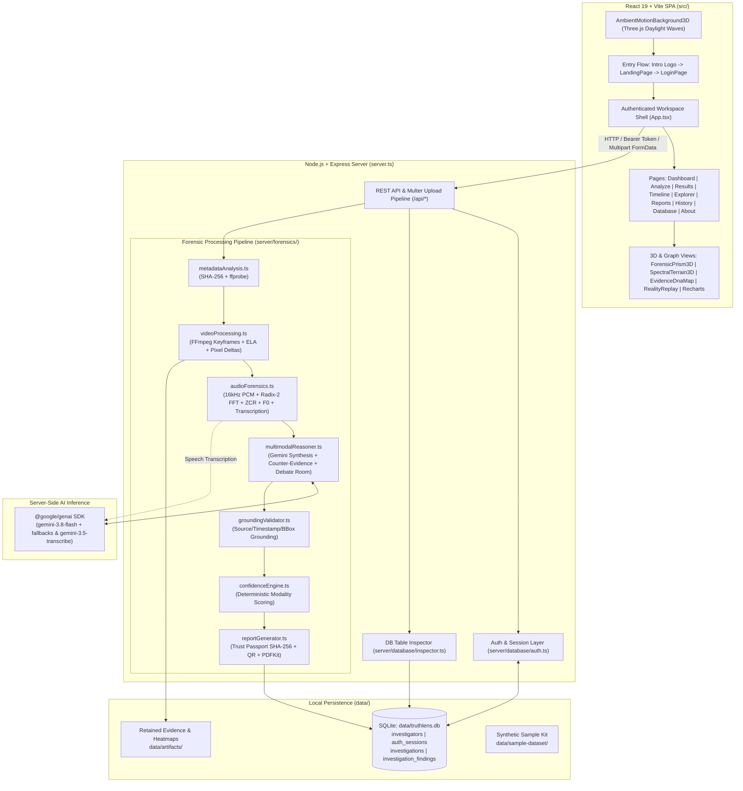

# TruthLens

**See Beyond the Surface. Verify What You Trust.**  
**Multimodal Digital Forensics & Deepfake Detection Platform** — *INNOVEDGE Hackathon 2026 (Track 4)*

---

## Table of Contents

1. [Overview](#overview)
2. [System Architecture](#system-architecture)
3. [End-to-End Workflow](#end-to-end-workflow)
4. [Tech Stack](#tech-stack)
5. [Database Schema](#database-schema)
6. [API Reference](#api-reference)
7. [Project Structure](#project-structure)
8. [Prerequisites & Environment Setup](#prerequisites--environment-setup)
9. [Running the Application](#running-the-application)
10. [Privacy, Security & Forensic Limitations](#privacy-security--forensic-limitations)

---

## Overview

**TruthLens** is a full-stack multimodal digital forensics platform engineered to inspect **images, videos, audio tracks, and contextual documents/claims** in parallel. Instead of producing opaque binary "real vs. fake" labels, TruthLens pairs measurable signal artifacts with:

- **Visual Compression & Frame Forensics**: Keyframe extraction, frame-to-frame pixel delta & luminance telemetry, and Error Level Analysis (ELA) compression heatmaps.
- **Acoustic Signal DSP & Transcription**: 16 kHz mono PCM decoding, waveform envelopes, RMS energy, Zero-Crossing Rate (ZCR), Radix-2 FFT spectral centroid & bandwidth, 13-band log spectral energy, autocorrelation pitch (`F0`), noise-floor drop detection, and timestamped speech transcription.
- **Container & Provenance Inspection**: `ffprobe` stream/codec/encoder inspection and SHA-256 cryptographic hashing of every uploaded source artifact.
- **Counter-Evidence & Forensic Debate Room**: Server-side multimodal reasoning that generates grounded findings paired with **benign alternative explanations** and a three-role adversarial review (**Investigator**, **Skeptic**, **Adjudicator**).
- **Deterministic Confidence & Grounding Validation**: Server-side validation of source IDs, timestamps, and normalized bounding boxes (`box_2d`), followed by deterministic score aggregation across available modalities.
- **Cryptographic Trust Passport & Exports**: Tamper-evident SHA-256 report digests, QR verification codes, PDFKit forensic dossiers, and raw JSON exports.
- **SQLite Persistence**: Local persistence for investigator accounts, active sessions, saved investigations, normalized finding records, human review decisions, and media-purge controls.

---

## System Architecture



### Architectural Layers

1. **Presentation Layer (`src/`)**
   - Built with **React 19**, **TypeScript**, **Tailwind CSS v4**, and **Motion (`motion/react`)**.
   - **Three.js** powers both the daylight frosted-glass ambient radiation canvas (`AmbientMotionBackground3D.tsx`) and interactive forensic inspection instruments (`ForensicPrism3D.tsx`, `SpectralTerrain3D.tsx`).
   - **React Flow (`@xyflow/react`)** renders the interactive cross-modal relationship graph (`EvidenceDnaMap.tsx`), while **Recharts** renders temporal anomaly scatter plots, RMS/ZCR charts, and spectral centroid/bandwidth graphs.
2. **Application Server & API Gateway (`server.ts`)**
   - Single **Express** entry point mounting Vite middleware in development (`npm run dev`) and serving static compiled bundles in production (`npm run start`).
   - Handles multipart evidence uploads via **Multer** (`max 6 files`, `50 MB/file`), static serving of `/artifacts` and `/sample-dataset`, Bearer-token authentication, and forensic orchestration.
3. **Forensic Processing & Reasoning (`server/forensics/`)**
   - Executes deterministic signal processing (`ffmpeg`, `ffprobe`, Radix-2 FFT, SHA-256) prior to LLM synthesis so AI reasoning is anchored to verifiable measurements.
   - Server-side **Gemini** calls (`server/geminiClient.ts`) implement model fallback chains and exponential backoff with jitter. API keys remain strictly server-side.
4. **Persistence Layer (`server/database/` + `data/truthlens.db`)**
   - Uses Node.js 22 built-in **`node:sqlite`** (`DatabaseSync`) with zero external DB server dependencies.
   - Stores normalized relational records alongside serialized JSON investigation payloads and retained frame/ELA artifacts.

---

## End-to-End Workflow

### 1. Application Entry & Session Lifecycle
1. **Intro Splash**: Every browser load/reload opens with a ~1.5s **TruthLens** pop-up logo animation (`showIntroLogo`).
2. **Opening Page (`LandingPage`)**: Displays a daylight frosted-glass portal card over the 3D motion canvas with the **Visit Portal** action.
3. **Investigator Portal (`LoginPage`)**: Supports investigator **Sign In** and **Register** backed by salted `crypto.scryptSync` password hashes and Bearer session tokens in SQLite (`auth_sessions`).
4. **Reload Behavior**: Reloading the browser restarts cleanly from the entry sequence (Intro Logo → Opening Page → Login Portal) for fresh access control, while **preserving all analytics results** (`stats`, `historyList`, active `InvestigationReport`, and selected view tabs/filters) from SQLite and `localStorage` once signed back in.

### 2. Multimodal Forensic Investigation Workflow
1. **Evidence Intake (`AnalyzePage`)**:
   - Upload up to 6 evidence files (`.jpg`, `.jpeg`, `.png`, `.webp`, `.mp4`, `.mov`, `.avi`, `.mkv`, `.wav`, `.mp3`, `.m4a`, `.txt`, `.pdf`) or click **Attach Sample Case** to populate the synthetic multimodal test kit.
   - Optionally enter unverified contextual claims (caption, claimed speaker, location, event, source description), confirm authorization consent, and toggle local media retention.
2. **Server-Side Analysis Pipeline (`POST /api/analyze`)**:
   - Computes **SHA-256** source digests and extracts container metadata via **`ffprobe`**.
   - Generates **Error Level Analysis (ELA)** compression heatmaps for images and extracts keyframes + frame-delta/luminance metrics for videos via **`ffmpeg`**.
   - Decodes audio streams to 16 kHz mono PCM, computes DSP metrics (RMS, ZCR, Radix-2 FFT spectral centroid/bandwidth, 13-band energy, `F0`, noise-floor drops), and generates timestamped speech transcripts.
   - Synthesizes cross-modal observations, benign counter-hypotheses, and the 3-perspective Debate Room via **Gemini** (`gemini-3.8-flash` primary with fallbacks).
   - Grounds findings (`validateAndGroundFindings`), computes deterministic modality confidence indices (`calculateConfidenceAndAssessment`), builds the **Trust Passport** (`report_sha256` + QR code), and persists everything into SQLite.
3. **Inspection, Human Review & Reporting**:
   - **Home Dashboard (`DashboardPage`)**: Live SQLite KPIs, interactive 3D Signal Core (`ForensicPrism3D`), recent investigations table, and one-click **Open Active Results**.
   - **Analysis Results (`ResultsPage`)**: Review confidence breakdown (`ConfidencePanel`), individual findings with benign counter-evidence and SQLite-persisted human review controls (`Confirmed`, `Benign`, `Secondary Review`, `Unreviewed`), **Forensic Debate Room**, **Evidence DNA Map**, **3D Signal Core**, and **Cross-Modal & Context** correlation matrix.
   - **Suspicious Timeline (`TimelinePage`)**: Synchronized **Reality Replay** media scrubber linked to a Recharts temporal anomaly scatter plot and chronological event ledger.
   - **Evidence Explorer (`ExplorerPage`)**: Frame-by-frame **Original vs. ELA Heatmap** visual comparator with normalized bounding-box overlays, **3D Spectral Terrain**, DSP telemetry charts, transcript, and container metadata inspector.
   - **Forensic Reports (`ReportsPage`)**: Download cryptographic **PDF** (`PDFKit`) or **JSON** dossiers and verify any Investigation ID / SHA-256 prefix against the local SQLite registry (`/api/verify/:id`).
   - **Analysis History (`HistoryPage`)**: Search/filter past live and reference investigations, reopen dossiers, purge retained media files (`POST /api/investigations/:id/purge-media`), or delete records.
   - **Database Tables (`DatabasePage`)**: Authenticated live schema and sanitized row inspector for all SQLite tables (`investigators`, `auth_sessions`, `investigations`, `investigation_findings`).

---

## Tech Stack

| Layer | Technologies |
| :--- | :--- |
| **Frontend UI** | React `19.0.1`, TypeScript `~7.0.2`, Vite `8.3.0`, Tailwind CSS `4.3.3` (`@tailwindcss/vite`), Motion (`motion/react` `12.23.24`), Lucide Icons (`lucide-react`) |
| **3D & Visualization** | Three.js `0.187.0` (`@types/three`), React Flow (`@xyflow/react` `13.0.2`), Recharts `3.11.0` |
| **Backend Server** | Node.js `22+`, Express `4.21.2`, Multer `2.5.0`, TSX `4.21.0`, `dotenv` |
| **Media & Signal DSP** | `ffmpeg` & `ffprobe` (CLI), custom Radix-2 FFT / ZCR / F0 / 13-band spectral DSP engine, Error Level Analysis (ELA) |
| **AI & Multimodal Reasoning** | `@google/genai` `2.4.0` (`gemini-3.8-flash`, `gemini-4-hydrogen`, `gemini-3.1-flash-lite`, `gemini-3.5-transcribe`) |
| **Database** | SQLite via Node built-in `node:sqlite` (`DatabaseSync` at `data/truthlens.db`) |
| **Reporting & Crypto** | Node `crypto` (`scryptSync`, `timingSafeEqual`, SHA-256), `pdfkit` `0.20.2`, `qrcode` `1.5.4` |

---

## Database Schema

TruthLens persists state locally in `data/truthlens.db` across four tables:

| Table | Purpose | Key Columns |
| :--- | :--- | :--- |
| **`investigators`** | Registered examiner accounts | `id` (PK), `email` (UNIQUE), `full_name`, `organization`, `role_title`, `password_salt`, `password_hash`, `created_at` |
| **`auth_sessions`** | Active Bearer login tokens | `token` (PK), `user_id`, `submitted_context_json`, `created_at`, `expires_at` |
| **`investigations`** | Saved forensic reports & KPI summaries | `investigation_id` (PK), `title`, `mode`, `created_at`, `primary_filename`, `source_count`, `assessment_category`, `overall_indicator_index`, `suspicious_count`, `needs_review_count`, `confirmed_count`, `report_sha256`, `media_purged`, `payload_json` |
| **`investigation_findings`** | Normalized per-finding index for querying & inspection | `(investigation_id, finding_id)` (PK), `modality`, `severity`, `indicator_title`, `confidence_score`, `timestamp_sec`, `review_status`, `source_id` |

---

## API Reference

| Method & Endpoint | Description |
| :--- | :--- |
| `GET /api/health` | Server health, Gemini model configuration status, upload limits, and sample dataset inventory |
| `POST /api/auth/login` | Authenticate investigator credentials and issue a Bearer session token |
| `POST /api/auth/register` | Register a new investigator account and start a session |
| `GET /api/auth/session` | Validate active `Authorization: Bearer <token>` session |
| `POST /api/auth/logout` | Invalidate the active session token |
| `GET /api/sample-dataset` | List synthetic sample media files available for testing |
| `GET /api/dashboard` | Compute live KPI totals and recent investigations from SQLite |
| `GET /api/investigations` | List all persisted investigation summaries |
| `GET /api/investigations/:id` | Retrieve full `InvestigationReport` JSON payload by ID |
| `POST /api/analyze` | Multipart upload + full multimodal forensic analysis pipeline |
| `POST /api/demo` | Generate and persist a deterministic offline reference investigation |
| `PATCH /api/investigations/:id/findings/:findingId/review` | Persist investigator review status & notes and recompute confidence + Trust Passport hash |
| `POST /api/investigations/:id/purge-media` | Delete retained media artifacts for an investigation while preserving the report |
| `DELETE /api/investigations/:id` | Delete an investigation and its normalized findings/artifacts |
| `GET /api/investigations/:id/export/pdf` | Generate and download a forensic PDF dossier via `PDFKit` |
| `GET /api/investigations/:id/export/json` | Download raw JSON investigation dossier |
| `GET /api/verify/:id?hash=...` | Verify an investigation ID and optional SHA-256 prefix against SQLite |
| `GET /api/database/tables` | *(Authenticated)* Return live SQLite table schemas (`PRAGMA table_info`) and sanitized rows |

---

## Project Structure

```text
.
├── index.html                          # HTML entry point & metadata
├── metadata.json                       # Applet manifest & capabilities
├── package.json                        # Scripts & dependencies
├── tsconfig.json                       # TypeScript compiler config
├── vite.config.ts                      # Vite + Tailwind v4 configuration
├── .env.example                        # Environment variable template
├── server.ts                           # Express + Vite server & REST API routes
├── server/
│   ├── config.ts                       # Upload limits, paths, detector versions, model config
│   ├── geminiClient.ts                 # @google/genai client, fallback chain & backoff retries
│   ├── database/
│   │   ├── auth.ts                     # SQLite investigator auth & session management
│   │   ├── history.ts                  # SQLite investigations & normalized findings CRUD
│   │   └── inspector.ts                # Live SQLite schema & sanitized row inspector
│   └── forensics/
│       ├── audioForensics.ts           # 16kHz PCM decoding, Radix-2 FFT, ZCR, F0 & transcription
│       ├── confidenceEngine.ts         # Deterministic confidence & assessment scoring
│       ├── demoAndSamples.ts           # Synthetic test dataset & offline demo generator
│       ├── groundingValidator.ts       # Validates sources, timestamps & normalized box_2d
│       ├── metadataAnalysis.ts         # SHA-256 digests & ffprobe stream inspection
│       ├── multimodalReasoner.ts       # Gemini multimodal synthesis, counter-evidence & debate
│       ├── reportGenerator.ts          # Trust Passport SHA-256, QR codes & PDFKit builder
│       └── videoProcessing.ts          # FFmpeg keyframe extraction, pixel deltas & ELA heatmaps
└── src/
    ├── App.tsx                         # Entry flow, workspace shell, navigation & state restoration
    ├── main.tsx                        # React root mount
    ├── index.css                       # Global Tailwind v4 styles & light glassmorphic surfaces
    ├── lib/formatters.ts               # Date, byte, timestamp, email masking & badge helpers
    ├── types/forensics.ts              # Shared frontend/backend TypeScript domain types
    ├── components/
    │   ├── AmbientMotionBackground3D.tsx # Three.js daylight 3D radiation waves & crystal core
    │   ├── ConfidencePanel.tsx         # Modality & overall confidence breakdown UI
    │   ├── DebateRoomPanel.tsx         # Investigator / Skeptic / Adjudicator debate view
    │   ├── EvidenceDnaMap.tsx          # React Flow cross-modal evidence relationship graph
    │   ├── FindingReviewCard.tsx       # Finding card with counter-evidence & review controls
    │   ├── ForensicPrism3D.tsx         # Interactive 3D Signal Core inspection instrument
    │   ├── RealityReplay.tsx           # Synchronized video/audio/frame evidence scrubber
    │   ├── SeverityBadge.tsx           # Assessment & severity indicators
    │   └── SpectralTerrain3D.tsx       # 3D acoustic spectral terrain mesh
    └── pages/
        ├── LandingPage.tsx             # Frosted glassmorphism opening card
        ├── LoginPage.tsx               # Investigator sign-in & registration portal
        ├── DashboardPage.tsx           # KPIs, 3D Signal Core & recent investigations
        ├── AnalyzePage.tsx             # Drag-and-drop multimodal upload & context intake
        ├── ResultsPage.tsx             # Findings, Debate Room, DNA Map, 3D Core & Cross-Modal
        ├── TimelinePage.tsx            # Reality Replay & temporal anomaly scatter plot
        ├── ExplorerPage.tsx            # Original vs. ELA heatmap, audio DSP & metadata tables
        ├── ReportsPage.tsx             # PDF/JSON export & Trust Passport integrity verifier
        ├── HistoryPage.tsx             # Searchable registry with media purge & delete actions
        ├── DatabasePage.tsx            # Live SQLite schema & row inspector
        └── AboutPage.tsx               # Methodology, limitations & reference walkthrough
```

---

## Prerequisites & Environment Setup

### System Requirements
- **Node.js 22+** (required for built-in `node:sqlite`)
- **`ffmpeg` and `ffprobe`** installed and available on `PATH`
- **Gemini API Key** (required for live multimodal AI inference and speech transcription; offline reference demo runs without a key)

### Environment Variables
Copy `.env.example` to `.env` (never commit `.env`):

```env
GEMINI_API_KEY="YOUR_GEMINI_API_KEY"
APP_URL="http://localhost:3000"
GEMINI_PRIMARY_MODEL="gemini-3.8-flash"
GEMINI_FALLBACK_MODELS="gemini-4-hydrogen,gemini-3.1-flash-lite"
GEMINI_TRANSCRIBE_MODEL="gemini-3.5-transcribe"
```

---

## Running the Application

```bash
# 1. Install dependencies
npm install

# 2. Start development server (Express API + Vite SPA on port 3000)
npm run dev

# 3. Type-check TypeScript
npm run lint

# 4. Build production frontend bundle
npm run build

# 5. Start production server on port 3000
npm run start
```

### Pushing to GitHub
If pushing from a local clone or freshly initialized repository:

```bash
git init -b main
git add .
git commit -m "Initial commit: TruthLens multimodal digital forensics platform"
git remote add origin https://github.com/<your-username>/<your-repo>.git
git push -u origin main
```

---

## Privacy, Security & Forensic Limitations

- **Server-Side Secret Isolation**: `GEMINI_API_KEY` is read exclusively by `server/` and is never bundled into client assets.
- **Data Minimization & Media Purge**: Analysts can disable raw media retention at intake or purge stored artifacts anytime from **Analysis History** while keeping cryptographic verification digests.
- **Forensic Scope Disclaimer**:
  - Social-platform re-encoding commonly strips EXIF/creation metadata and alters quantization tables without malicious manipulation.
  - Acoustic DSP anomalies (spectral cutoffs, sudden noise-floor drops) can occur in normal studio noise gates or editorial cuts.
  - **Absence of detected indicators never constitutes proof of authenticity**; all automated findings require qualified human investigator review.
